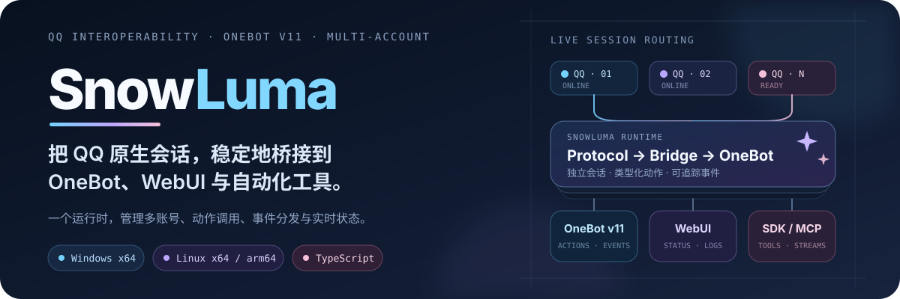
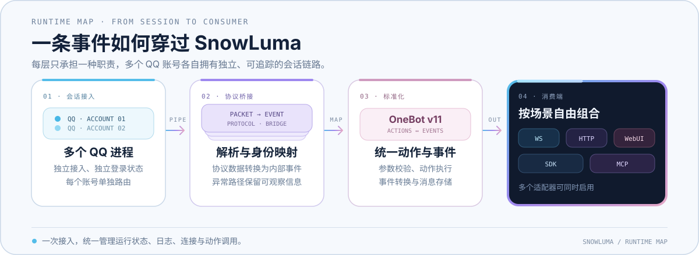

<p align="center">
  
</p>

<p align="center">
  <a href="https://github.com/SnowLuma/SnowLuma/releases"></a>
  <a href="https://github.com/SnowLuma/SnowLuma/actions/workflows/dev-build.yml"></a>
  <a href="https://www.npmjs.com/package/@snowluma/sdk"></a>
  <a href="https://www.npmjs.com/package/@snowluma/mcp"></a>
  <a href="https://github.com/SnowLuma/SnowLuma/stargazers"></a>
</p>

<p align="center">
  <a href="#快速开始">快速开始</a> ·
  <a href="https://snowluma.github.io/zh/docs/api">动作参考</a> ·
  <a href="https://github.com/SnowLuma/SnowLuma/issues">问题反馈</a>
</p>

SnowLuma 是面向 QQ 客户端的 TypeScript 互操作运行时，将 QQ 原生会话转换为 [OneBot v11](https://github.com/botuniverse/onebot-11) 动作与事件，并通过 WebSocket、HTTP、WebUI、SDK 和 MCP 提供统一入口。

> [!CAUTION]
> SnowLuma 是独立的第三方项目，与腾讯 / QQ 无隶属或授权关系。项目仅供学习与技术研究，请遵守《QQ 用户协议》及适用法律；软件按“现状”提供，使用风险自负。详见 [`EULA.md`](EULA.md)。
>
> **Disclaimer:** SnowLuma is independent of Tencent / QQ and is provided for study and research only, “as is” and without warranty.

## 核心能力

| 场景 | 能力 |
| --- | --- |
| OneBot 接入 | OneBot v11 动作与事件；WebSocket 服务端 / 客户端及 HTTP 服务端 / 上报 |
| 消息与媒体 | 文本、图片、语音、视频、文件、回复、提及、转发及常见卡片 |
| 多账号运行 | 各账号独立维护会话、身份映射、消息存储和网络配置 |
| WebUI 管理 | 账号状态、实时日志、连接配置、动作调试和存储管理 |
| 开发者工具 | [`@snowluma/sdk`](packages/sdk/README.md) 与 [`@snowluma/mcp`](packages/mcp/README.md) |

## 运行链路

<p align="center">
  
</p>

会话接入、协议解析、身份映射、OneBot 转换和网络适配保持独立边界；多个 QQ 账号可并行运行。

## 快速开始

1. 从 [Releases](https://github.com/SnowLuma/SnowLuma/releases) 下载对应平台的完整发行包并解压。Lite 版需 Node.js 24+。
2. Windows 运行 `launcher.bat`；Linux 执行：

   ```bash
   chmod +x launcher.sh
   ./launcher.sh
   ```

3. 打开 [`http://localhost:5099`](http://localhost:5099)，使用启动日志中的初始密码登录 WebUI，按引导接入 QQ 进程并配置 OneBot 连接。

账号识别由登录数据库的文件变化、进程和登录事件或手动操作触发，不做周期探测。未载入的 QQ 进程也不会持续调用 Windows Restart Manager；需要重查时可点击 WebUI 进程行的刷新/重连。

## 接入与文档

| 入口 | 文档 |
| --- | --- |
| WebSocket / HTTP | [OneBot 动作参考](https://snowluma.github.io/zh/docs/api) |
| 部署（Docker / Windows） | [部署指南](https://snowluma.github.io/zh/docs/guide/deploy) |
| TypeScript SDK | [`packages/sdk/README.md`](packages/sdk/README.md) |
| MCP | [`packages/mcp/README.md`](packages/mcp/README.md) |

JSON 消息段接受标准的 `data.data` 字符串，也兼容 `data.data` 非数组对象和 `{ type: "json", data: "..." }` 简写；`data` 必填，最终内容必须是 JSON 对象。

### 好友资料字段

`get_friend_list` 的好友条目，以及 `get_friends_with_category` 的 `buddyList` 条目，在基本的 `user_id`、`nickname`、`remark` 之外，还可返回以下扩展字段：

| 字段 | 类型 | 含义 |
| --- | --- | --- |
| `long_nick` | 字符串 | 个性签名，可为空字符串 |
| `birthday_year`、`birthday_month`、`birthday_day` | 整数 | 生日年月日；年份为 `0` 时表示上游未提供公开年份 |
| `age` | 整数 | 上游返回的年龄 |
| `sex` | 字符串 | `male`、`female` 或 `unknown` |
| `phone_num` | 字符串 | 上游返回的电话号码，可能经过脱敏 |
| `email` | 字符串 | 上游返回的邮箱 |
| `category_id` | 整数 | 好友分组 ID |
| `level` | 整数 | QQ 等级 |
| `country`、`province`、`city` | 字符串 | 用户自填的国家、省份和城市 |
| `college` | 字符串 | 用户自填学校 |
| `is_qq_vip`、`is_vip`、`is_years_vip` | 布尔值 | 普通会员、超级会员和年费会员状态 |
| `vip_level` | 整数 | 会员等级 |
| `profile_business` | 数组 | QQ 业务编号、等级、年费标志、高级业务标志及可选图标；保留未知业务编号 |

好友分页列表缺少资料时，这两个 OneBot 动作会尝试请求该好友的用户资料，仅补充缺少的字段。资料补全缓存按当前账号的 Bridge 实例隔离，以好友 QQ 号为键，6 小时内优先复用缓存，并合并同一好友的并发请求；同一账号的列表补全最多同时请求 4 位好友。缓存过期后的补全会重新查询；查询失败或仅执行内部名单刷新时，可复用该账号最后成功取得的资料，不会因临时失败清空已有字段。成功的资料响应未包含某字段时，会更新缓存，旧值不再用于补全。单个好友的资料请求失败后，该好友在 60 秒内不再次尝试补全，其他好友仍可正常返回。首次读取或缓存到期后的读取需要逐个查询缺资料的好友，好友较多或请求超时时可能需要更长时间。

`get_stranger_info` 同步输出可用的生日、电话、邮箱、地区、学校、会员状态和业务资料，并提供 `level` 等级别名。`profile_business` 条目包含 `type`、`level`、`is_year`、`is_pro` 和可选的 `icon`，不等同于客户端完整的特权图标结构。实际可见字段取决于 QQ 服务端、账号关系及隐私设置；可选字段未返回或无法解析时会省略，不保证每个账号都有完整资料，也不会据生日自行推算年龄、还原脱敏号码或编造登录天数。当前实现经过本地协议及动作测试，实际返回情况仍需使用真实 QQ 账号验证。

## 开发

需要 Node.js 24+ 与 pnpm 11.25.0，日常开发基于 `dev` 分支：

```bash
git clone https://github.com/SnowLuma/SnowLuma.git
cd SnowLuma
git checkout dev
pnpm install --frozen-lockfile
pnpm typecheck
pnpm test
```

贡献流程见 [`CONTRIBUTING.md`](CONTRIBUTING.md)；模块边界与项目词汇见 [`CONTEXT.md`](CONTEXT.md)；开发方向见 [`RoadMap.md`](RoadMap.md)。

## 使用边界与许可

> [!IMPORTANT]
> SnowLuma 使用**源码可见非商业许可**，不是 OSI 开源许可。源码可用于查看、学习、非商业自托管及私下修改；商业使用，以及公开发布修改版或衍生版，均需事先取得书面授权。

完整条款见 [`LICENSE`](LICENSE)；二进制发行包另受 [`EULA.md`](EULA.md) 与 [`PRIVACY.md`](PRIVACY.md) 约束；商业授权请联系 `motricseven@foxmail.com`。随附的原生附加组件为专有组件，不在源码许可范围内。

SnowLuma is source-available for study and non-commercial self-hosting, but it is not OSI open source. Commercial use and public distribution of modified or derivative versions require prior written permission.

## 社区与鸣谢

- [提交问题](https://github.com/SnowLuma/SnowLuma/issues)
- [QQ 群](https://qm.qq.com/q/g3UMLpWALe)
- [Telegram](https://t.me/napcatqq)

项目参考了 [LagrangeV2](https://github.com/LagrangeDev/LagrangeV2) 的协议定义与 [NapCatQQ](https://github.com/NapNeko/NapCatQQ) 的实现思路。

<p align="center">
  <a href="https://github.com/SnowLuma/SnowLuma/graphs/contributors"></a>
</p>
